# 📡 Azure AKS Observability Stack: Fully Automated Monitoring with Terraform

[](https://www.terraform.io/)
[](https://azure.microsoft.com/products/kubernetes-service)
[](https://azure.microsoft.com/products/managed-grafana)
[](https://learn.microsoft.com/azure/azure-monitor/essentials/prometheus-metrics-overview)
[]()

A complete, production-style **observability platform for Azure Kubernetes Service (AKS)**, provisioned end-to-end with a single `terraform apply`. The cluster, the monitoring pipeline, the alert rules, **and every dashboard** are defined as code, so the whole environment can be destroyed and rebuilt identically, any number of times.

## 🌟 Project Overview

This repository deploys an AKS cluster (Linux + Windows node pools) running a real microservices workload, and wraps it in three complementary monitoring layers:

| Layer | What it gives you |
|---|---|
| **Azure Portal Dashboard** | At-a-glance node and CPU health, pinned to the Azure Portal |
| **Azure Monitor Workbook** | Deep-dive KQL diagnostics: restarts, OOMKills, error logs, network and disk |
| **Azure Managed Grafana** | Prometheus-based cluster, node, pod and container metrics |

On top of that, **KQL-based alert rules** watch the cluster around the clock and send e-mail notifications when pods or nodes become unhealthy.

## 🚀 Key Features

* **100% Infrastructure as Code, Including Dashboards:** Nothing is clicked together in the portal. AKS, Log Analytics, Managed Prometheus, Managed Grafana, alert rules, the Azure dashboard, the Workbook and the Grafana dashboard are all created by Terraform.
* **Dashboards-as-Code with Dynamic Templates:** Dashboards were designed visually in the UI, exported to JSON, and converted into Terraform templates (`.tftpl`). Every hardcoded value (Resource IDs, subscription, resource group, cluster name, workspace, datasource) was replaced with a template variable that Terraform injects at deploy time.
* **Idempotent & Reproducible:** Because no environment-specific value is hardcoded, `destroy` → `apply` produces the exact same result every time. The same code can be deployed to a different subscription, region or environment by changing only `prefix`, `environment` and `location`.
* **Three Monitoring Layers, One Deployment:** Azure-native (Dashboard + Workbook on Log Analytics) and open-source style (Managed Prometheus + Grafana) side by side, so you can compare approaches on the same live cluster.
* **Proactive Alerting:** Scheduled KQL alert rules run every 5 minutes (Severity 1) and notify an Action Group by e-mail when:
  * a pod enters `Failed` / `Pending` / `Unknown` state or restarts,
  * a node is not `Ready`.
* **Managed Prometheus Pipeline:** Data Collection Endpoint, Data Collection Rule and its AKS association are wired automatically, so Prometheus metrics flow into an Azure Monitor Workspace without installing or maintaining any Prometheus server.
* **Least-Privilege, Identity-Based Access:** No passwords or keys between services. Managed Identities and scoped RBAC roles (`Monitoring Metrics Publisher`, `Monitoring Data Reader`, `Log Analytics Reader`, `Grafana Admin`) connect everything.
* **Dependency & Timing Aware:** Azure needs a few minutes to propagate RBAC roles on Managed Grafana. Explicit `depends_on` chains and a time-based wait prevent the race-condition errors you normally hit on the first apply.
* **Hybrid Cluster:** Linux (`Ubuntu`) system pool plus a Windows Server 2022 pool, with Container Insights enabled for both.
* **Real Workload Out of the Box:** The official [AKS Store Demo](https://github.com/Azure-Samples/aks-store-demo) is deployed automatically through Terraform, so dashboards show live data immediately.
* **Secrets Hygiene:** Sensitive variables are marked `sensitive`, and `*.tfstate` / `*.tfvars` files are git-ignored.

## 🛠️ Technology Stack

* **Infrastructure Provisioning:** Terraform (`azurerm`, `kubectl`, `http`, `grafana`, `azuread`, `time` providers)
* **Compute:** Azure Kubernetes Service (Linux + Windows node pools, Azure CNI, OIDC issuer, Workload Identity)
* **Logs & Alerts:** Azure Monitor, Log Analytics Workspace, Container Insights, Scheduled Query Rules, Action Groups
* **Metrics:** Azure Monitor Workspace (Managed Prometheus), Data Collection Endpoint / Rule
* **Visualization:** Azure Portal Dashboard, Azure Monitor Workbook, Azure Managed Grafana
* **Sample Workload:** AKS Store Demo (microservices)

## 🗺️ Architecture

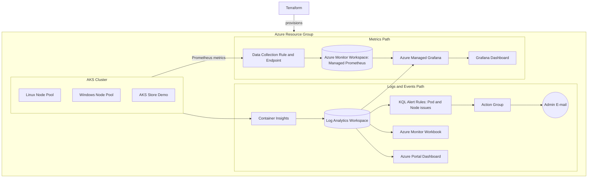

### 🔁 Dashboards-as-Code Flow

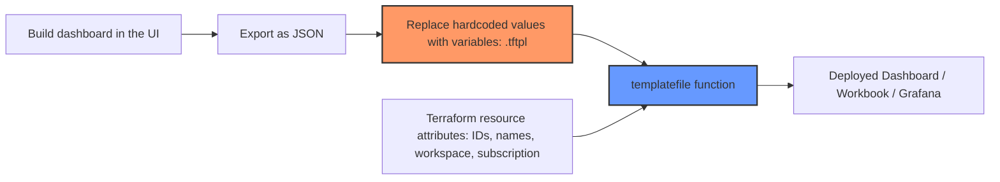

## 📂 Repository Structure

```text
.
├── terraform/
│   ├── versions.tf                  # Providers & versions
│   ├── variables.tf                 # Input variables
│   ├── aks.tf                       # Resource Group, AKS, node pools, demo workload
│   ├── observability.tf             # Log Analytics, alerts, Azure dashboard, Workbook
│   ├── managed-grafana.tf           # Managed Prometheus, Managed Grafana, RBAC, Grafana dashboard
│   ├── azure-dashboard.json.tftpl   # Azure Portal Dashboard template
│   ├── azure-workbook.json.tftpl    # Azure Monitor Workbook template
│   └── grafana-dashboard.json.tftpl # Grafana dashboard template
├── monitoring-screenshots/          # Screenshots of the deployed result
├── monitoring.pdf                   # Short visual report
└── .gitignore
```

## ⚙️ Deployment Prerequisites

1. **Azure Subscription** with permission to create AKS, monitoring resources and role assignments.
2. **Azure CLI**, authenticated with `az login`.
3. **Terraform** `>= 1.5.7`.

## ▶️ Quick Start

```bash
git clone https://github.com/R-Kx/Azure-Aks-Observability-Stack.git
cd Azure-Aks-Observability-Stack/terraform

az login
terraform init
terraform apply
```

Create a `terraform.tfvars` file (git-ignored) with your own values:

```hcl
prefix                    = "aks"
environment               = "dev"
location                  = "westeurope"
win_admin_username        = "azureadmin"
win_admin_password        = "<strong-password>"
admin_email               = "you@example.com"
principal_id              = "<your-azure-ad-object-id>"
prometheus_datasource_uid = "<grafana-prometheus-datasource-uid>"
```

After `apply`, the **Grafana URL** is printed as the `grafana_url` output.

To remove everything:

```bash
terraform destroy
```

> 💰 **Cost note:** two `Standard_D2s_v3` nodes and Managed Grafana (Standard) are billed while running. Destroy the environment when you are done.

## 🔧 Input Variables

| Variable | Description |
|---|---|
| `prefix` | Name prefix for all resources |
| `environment` | Environment name (e.g. `dev`) |
| `location` | Azure region |
| `win_admin_username` | Admin user for the Windows node pool |
| `win_admin_password` | Admin password for the Windows node pool (`sensitive`) |
| `admin_email` | E-mail address that receives alerts |
| `principal_id` | Object ID of the user who gets the `Grafana Admin` role |
| `prometheus_datasource_uid` | UID of the Prometheus datasource in Grafana |

## 📸 Result Gallery

### Azure Portal Dashboard
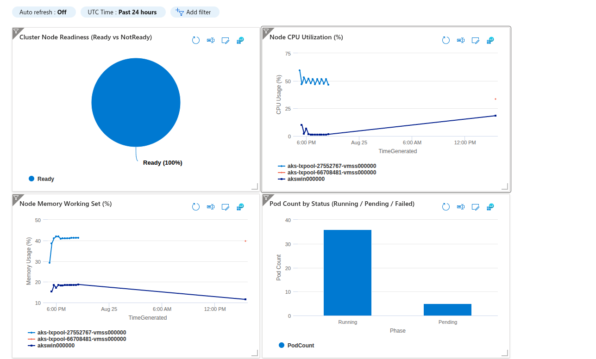
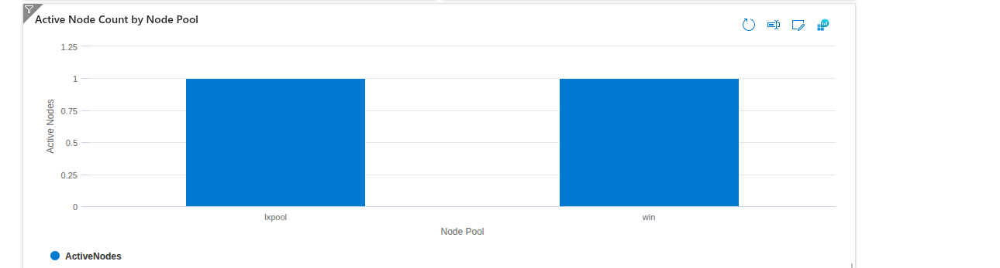

### Azure Monitor Workbook
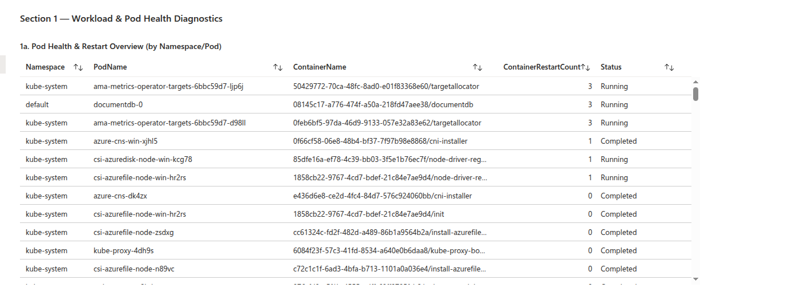
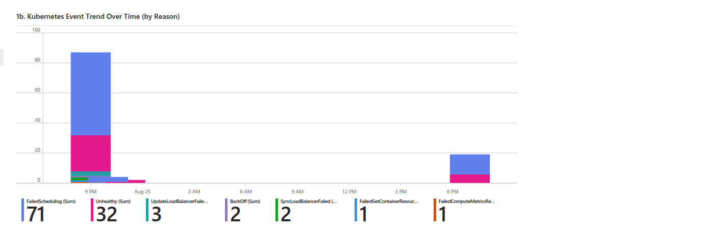
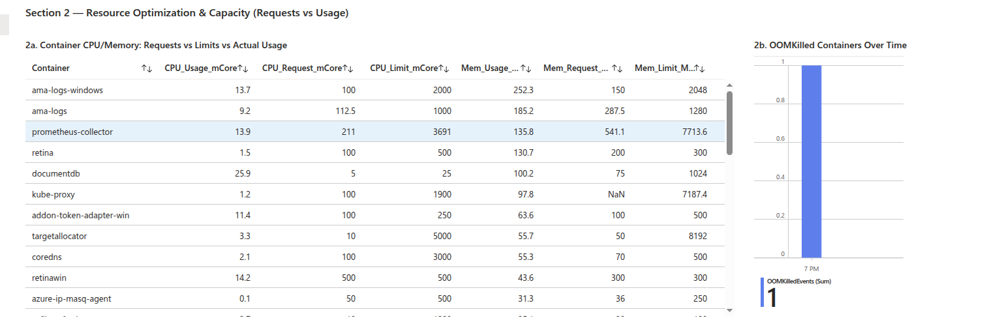
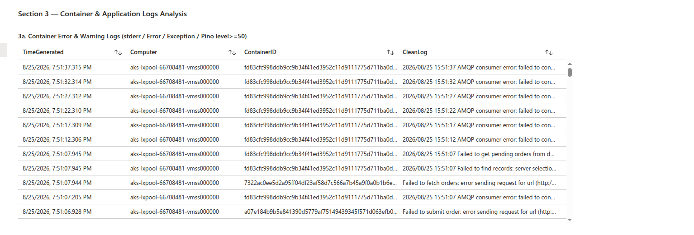
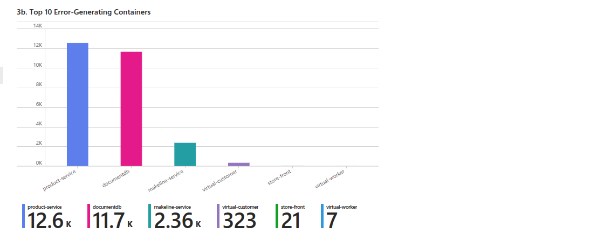
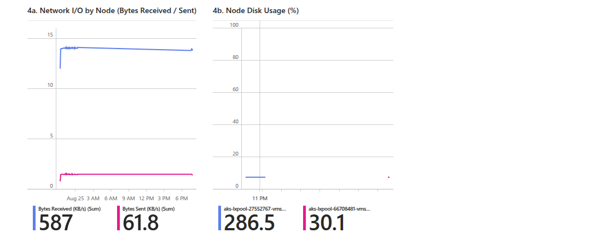

### Azure Managed Grafana
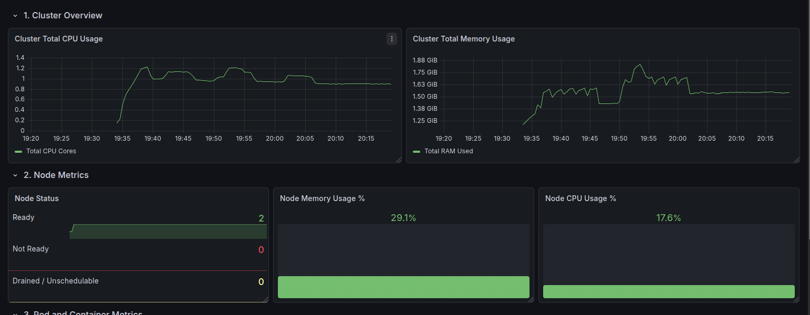
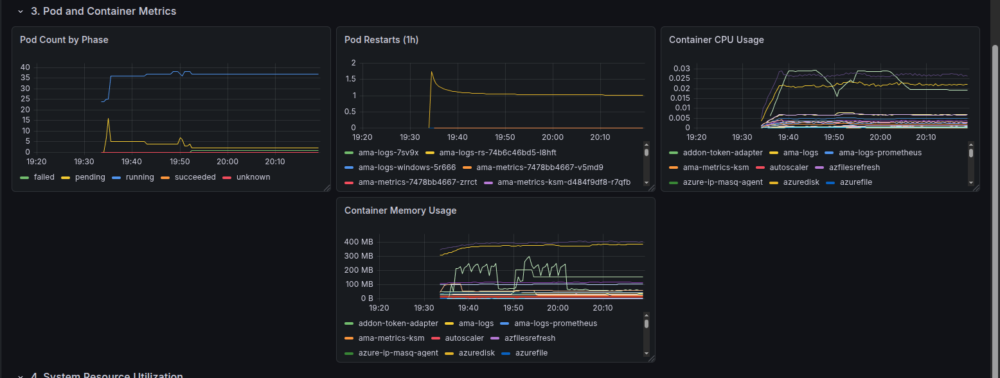
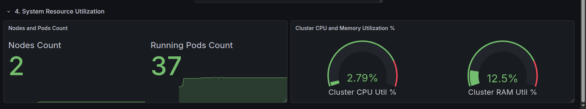

### Triggered E-mail Alerts
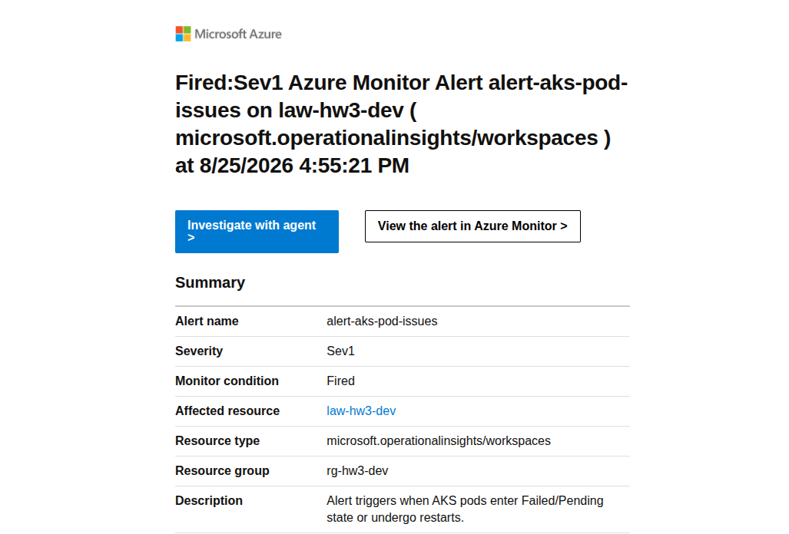
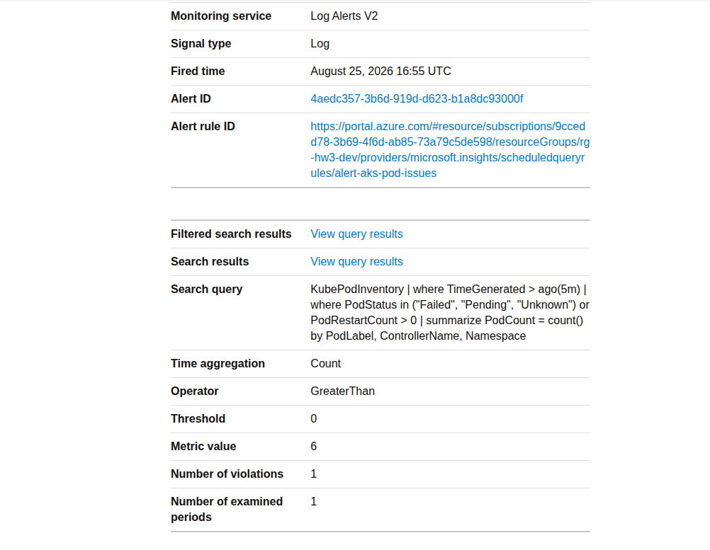

A condensed version of these screenshots is also available in [`monitoring.pdf`](monitoring.pdf).
